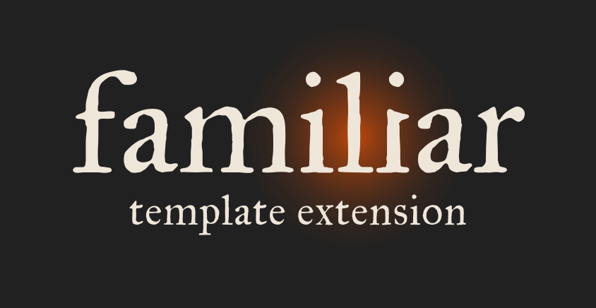

<p align="center">
  
</p>

# familiar-template

Starter scaffold for building your own familiar specialty extension — the same kind of drop-in
package as familiar's own extensions, minus the domain content. Click **Use this template** on
GitHub to get your own copy, rename everything, and build whatever your line of work needs:
marketing, consulting, proposal writing, and more. It stays compatible with familiar core by
construction, because the parts you must not touch are exactly the parts this template already gets
right for you.

## Build it with an AI agent

The easiest way to build an extension is to open your AI coding assistant (Claude Code, for example)
in your copy and tell it what your specialty is. `AGENTS.md` (loaded by `CLAUDE.md` and `GEMINI.md`) briefs the agent:
it interviews you about the jobs your specialty involves, proposes the skills, writes them in both
host copies, and checks them as it goes. `CORE-RULES.md` gives it the rules every familiar skill
lives inside (grounding, no fabrication, the project boundary, where state lives, retrieval), so what
it writes works with core rather than against it. You stay in charge: it asks before creating files.

Why "Use this template" and not fork: a fork stays linked to this repo and carries its history, and
is meant for sending changes back here. A template copy is your own clean repo.

## What this is not

This is not a copy of familiar core, and it does not need to be. Get core itself from
[github.com/familiar-md/familiar](https://github.com/familiar-md/familiar) the normal way — download
`familiar-workspace-<version>.zip` from its Releases page — and update it the normal way, on its own
schedule.
This template only ever contains the extension package: skills, agents, and the manifest that tells
core how to route to them. It merges onto a core project; it never contains one.

## Quickstart

1. Click "Use this template" on this repo.
2. Rename `familiar-yourspecialty` everywhere it appears — the folder under
   `.familiar/extensions/`, the `id`/`namespace` fields in `familiar-extension.json`, and every
   `familiar-yourspecialty-*` agent filename — to your specialty's namespace (e.g.
   `familiar-marketing`). Keep it lowercase, hyphenated, and stable once you publish; other people's
   projects will reference it.
3. Replace `example-skill` with your real skill(s): rename the folder under both `.claude/skills/`
   and `.agents/skills/`, rewrite `SKILL.md`, and update `familiar-extension.json`'s `routes` and
   `skills` arrays to match. Delete `example-agent` if you don't need a subagent, or rename and
   rewrite it the same way across its three host copies (`.claude/agents/`, `.codex/agents/`,
   `.gemini/agents/`). Separately, every skill folder under `.agents/skills/` needs its own
   `agents/openai.yaml` — the per-skill Codex invocation policy (`interface.display_name`,
   `policy.allow_implicit_invocation`). That file belongs to the skill, not to a subagent; keep it
   when you rename the skill folder, and add one to every new skill folder.
4. Run `python check_extension.py` (see "Check your extension" below), then work through
   `CONTRACT-CHECKLIST.md` before calling it done — that's the part that has to be exactly right for
   core to route to you at all.
5. Read `BUILDING-YOUR-SPECIALTY.md` for how to write the skill content itself — that part is yours
   to design; there's no required shape beyond the contract.
6. To try it: copy only `.claude/`, `.agents/`, `.codex/`, `.gemini/`, and `.familiar/` from your
   copy into the root of a real `familiar-workspace/`-based project, merging with what's there (see
   `_about.md` for the exact mechanics). Never copy this repo's `AGENTS.md`, `CLAUDE.md` or
   `GEMINI.md`: they would replace the project's own entry files. Open your assistant in that project.
   No install step.

## Check your extension

`check_extension.py` is a standard-library Python 3 script that checks your package against the
extension contract: manifest fields against the manifest schema, route namespace prefixes,
manifest-versus-disk parity for skills and agents, `.claude`/`.agents` skill parity, per-skill
`agents/openai.yaml`, agent naming across hosts, and the capability vocabulary. It prints PASS, FAIL
or WARN per check and exits 1 if anything fails.

```text
python check_extension.py                                  # checks the repo it sits in
python check_extension.py --project path/to/your-project   # also checks for collisions with core
```

Run on the unmodified template it reports FAIL for the placeholder `select_when` (an unrenamed
template is not shippable) and WARN for the placeholder names. Expect those until you rename and
rewrite. It does not replace `CONTRACT-CHECKLIST.md`: it cannot judge whether your `_about.md` lists
the right paths, whether your capability claims are honest, or whether your `core` range is accurate.

## Invoking your skills

Each host starts an explicit skill differently, so tell your users the form that matches theirs:

- Claude Code: `/ili-<skill>`, for example `/ili-example-skill`. Set `name: ili-<skill>` in the
  `.claude/skills/` copy of each SKILL.md (keep `name: <skill>` in the `.agents/` copy) so your
  skills list alongside core's when the user types `/ili`.
- Codex: `$<skill>`, or pick it from `/skills`.
- Gemini CLI: has no per-skill slash command. The user asks for the skill by name.

A skill with `disable-model-invocation: true` in its frontmatter is user-only: the agent names it and
tells the user how to start it rather than running it.

## If your specialty is aimed at other people

Nothing here assumes it's private. Once it's working, publish your copy as its own public repo and
add the **`familiar-extension`** topic to it (the gear icon next to "About" on the repo page).
Everyone who tags their repo that way is listed at
[github.com/topics/familiar-extension](https://github.com/topics/familiar-extension), which is
where familiar users go to find extensions. You can also mark your repo as a template, the same as
this one, so others can build their own copy of *your* specialty.

## Contract version

This scaffold targets extension contract `1.1` and core `>=1.0.0 <2.0.0`, matching
[`extension-contract.md`](https://github.com/familiar-md/familiar/blob/main/familiar-workspace/.familiar/core/extension-contract.md)
in familiar core, as of this template's `VERSION`. If core's
contract version moves, check that file before assuming this scaffold still applies as-is.
